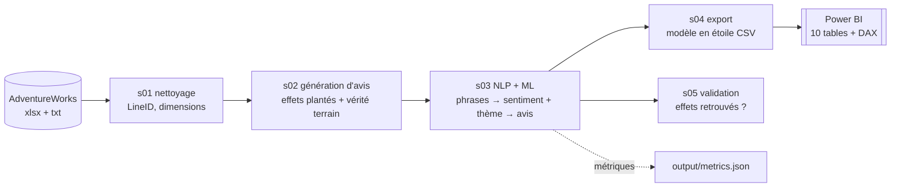

# Projet 12 — Analyser les avis clients avec l'IA : sentiment, thèmes et restitution Power BI

Pipeline reproductible **AdventureWorks → avis → NLP (sentiment + thèmes) → modèle en étoile Power BI**, avec évaluation chiffrée,
tests automatiques et validation de bout en bout.

> ⚠️ **Les avis sont synthétiques.** L'archive AdventureWorks ne contient aucun texte client. Les avis sont générés et rattachés
> à de vraies lignes de vente. Les chiffres de satisfaction sont donc des **résultats de démonstration, pas des conclusions métier**.
> Les « clients » d'AdventureWorks sont des **revendeurs** (ventes B2B), pas des consommateurs.

## Lancer (≈ 20 s)
```bash
pip install -r requirements.txt
# placer les fichiers de l'archive dans data_raw/  (FactSales/*.xlsx, DimProduct.txt, DimReseller.txt, ...)
python src/run_all.py
python -m pytest -q tests          # 22 tests
```
Graine fixée (`SEED=42`) : deux exécutions donnent des fichiers identiques (testé).

## Architecture


| Étape | Script | Sortie principale |
|---|---|---|
| 1 | `src/s01_prepare_sales.py` | `output/fact_sales.csv`, dimensions, objectifs dépivotés |
| 2 | `src/s02_generate_reviews.py` | `reviews_raw.csv`, vérité terrain, `planted_effects.json` |
| 3 | `src/s03_nlp_enrich.py` | `reviews_scored.csv`, `sentences_scored.csv`, `metrics.json` |
| 4 | `src/s04_export_powerbi.py` | `powerbi/*.csv` + `docs/dictionnaire_donnees.md` |
| 5 | `src/s05_validate_effects.py` | `docs/validation_effets.png` |

Autres : `src/ml_models.py` (modèles ML), `src/score_new_reviews.py` (scorer de nouveaux avis), `src/lexicons.py` (lexiques FR), `src/phrases.py` (banque de formulations), `src/stress_set.py` (jeu de test manuel),
`src/transformer_engine.py` (moteur optionnel **non testé**), `powerbi/` (DAX, M, guide), `docs/NOTE_PEDAGOGIQUE.md`.

## Résultats (mesurés, `output/metrics.json`)
Trois moteurs sont comparés ; **le modèle ML alimente Power BI** (`ENGINE = "ml"` dans `src/common.py`, repasser à `"lexique"` pour le comparer).

| Mesure | Lexique (règles) | TF-IDF seul (réf.) | **ML (production)** |
|---|---|---|---|
| Sentiment par phrase — test (formulations non vues) | 0,79 | 0,43 | 0,74 |
| Sentiment par phrase — jeu « stress » (24, à la main) | 0,92 | 0,71 | **0,96** |
| Thème par phrase — test | 0,997 *(optimiste)* | 0,75 | 0,997 *(optimiste)* |
| Thème par phrase — stress | 0,96 | 0,67 | 0,96 |
| Sentiment par **avis** — test (255 avis) | **0,64** | 0,32 | 0,58 |

Plafond théorique du sentiment par avis : **≈ 0,83** (la note de l'avis est bruitée).

**Le modèle ML** (`src/ml_models.py`) : régression logistique entraînée sur des phrases annotées, avec des variables d'entrée
calculées par phrase (score lexical, nombre de mots positifs/négatifs, négation, marqueur neutre, longueur) ; les thèmes ajoutent un TF-IDF.
Il apprend les poids et les seuils. Ses performances viennent de ces **variables lexicales** : essayés, des vecteurs de mots spaCy
n'ont pas amélioré le sentiment. Modèles sauvegardés dans `output/models/`.
**Honnêtement : le ML égale le lexique sur les phrases, il est un peu moins bon sur l'avis entier** (0,58 contre 0,64) ; un modèle
« 2 niveaux » essayé pour l'avis n'a pas fait mieux (0,55) et n'a pas été retenu.

Appliquer le modèle à de nouveaux avis : `python src/score_new_reviews.py avis.csv --col texte`.

Validation de bout en bout : les effets plantés sont retrouvés dans la bonne direction quand l'effectif est suffisant
(support par commercial r = 0,78 ; qualité VTT −0,26 vs route +0,40 ; prix des vélos −0,23 ; livraison Europe −0,15) —
`docs/validation_effets.png`. Les effets à faible effectif (Pacifique, date d'expédition manquante) sont **indicatifs seulement**.

## À lire ensuite
`docs/NOTE_PEDAGOGIQUE.md` (démarche, choix, difficultés, limites) · `powerbi/GUIDE_POWER_BI.md` (construction du rapport).
